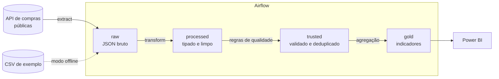

# 🛒 Pipeline ETL de Compras Públicas com Apache Airflow

Pipeline de dados que extrai diariamente **atas de registro de preço** de uma API de compras públicas, aplica regras de qualidade e carrega os dados numa base PostgreSQL organizada em **camadas** (Raw → Processed → Trusted → Gold), pronta para consumo em Power BI.

> Projeto baseado num pipeline real que coloquei em produção no setor público. Este repositório usa **dados sintéticos** e endpoints genéricos — nenhum dado ou credencial real está aqui.


## Arquitetura



| Camada | Conteúdo | Regra |
|---|---|---|
| `raw` | Payload original + data de carga | Nunca é alterado (auditoria/reprocessamento) |
| `processed` | Colunas tipadas, nomes padronizados | Conversão de datas, valores e textos |
| `trusted` | Dados validados | Sem duplicatas, sem valores negativos, vigência coerente |
| `gold` | Indicadores prontos para BI | Valor por fornecedor, atas vigentes x vencidas |

## Como executar

Pré-requisitos: Docker e Docker Compose.

```bash
git clone https://github.com/Carlos-Absalao/pipeline-etl-airflow-compras-publicas.git
cd pipeline-etl-airflow-compras-publicas
cp .env.example .env
docker compose up -d
```

Acesse o Airflow em http://localhost:8080 (usuário/senha definidos no `.env`) e ative a DAG `etl_atas_registro_preco`.
Por padrão a DAG roda em **modo offline**, lendo `data/sample/atas_exemplo.csv`. Para usar uma API real, defina `ATAS_API_URL` no `.env`.

Testes das regras de transformação (sem Docker):

```bash
pip install -r requirements.txt
pytest -q
```

## Estrutura

```
dags/
├── etl_atas_registro_preco.py   # definição da DAG
└── etl_lib/
    ├── extract.py               # API ou CSV → DataFrame
    ├── transform.py             # limpeza, tipagem e regras de qualidade
    ├── load.py                  # carga por camada via PostgresHook
    └── utils.py                 # mapeamento de colunas e helpers
sql/init/01_schemas.sql          # schemas e tabelas das camadas
data/sample/atas_exemplo.csv     # dados sintéticos
tests/test_transform.py
```

## Lições aprendidas em produção

Problemas reais que resolvi ao estabilizar a versão em produção — e como estão tratados aqui:

1. **Schema não qualificado na carga** — `to_sql` gravava no schema `public` em vez do schema de destino. Toda carga aqui recebe `schema=` explicitamente (`load.py`).
2. **SQLAlchemy 2.x × pandas** — `pd.read_sql` com engine quebrava após upgrade. Solução: `PostgresHook.get_pandas_df()` e `get_sqlalchemy_engine()` do próprio Airflow.
3. **CRLF e indentação** — DAGs editadas no Windows não eram parseadas no container Linux. O `.gitattributes` força `eol=lf`.
4. **Erro de digitação em renomeação de coluna** — um nome errado no mapeamento gerava coluna nula silenciosamente. O `transform.py` valida que todas as colunas esperadas existem e falha alto.
5. **Containers sem acesso à VPN no WSL2** — o Docker não herda a VPN do host. Documentado em [`docs/troubleshooting.md`](docs/troubleshooting.md) (incluindo `networkingMode=mirrored` no `.wslconfig`).

## Próximos passos

- [ ] Camada `historical` com SCD tipo 2 para vigências
- [ ] Alertas de falha via e-mail/Teams
- [ ] Testes de qualidade com Great Expectations

---
Autor: [Carlos Absalão](https://www.linkedin.com/in/carlos-absalao-dados-ia) · Licença MIT
